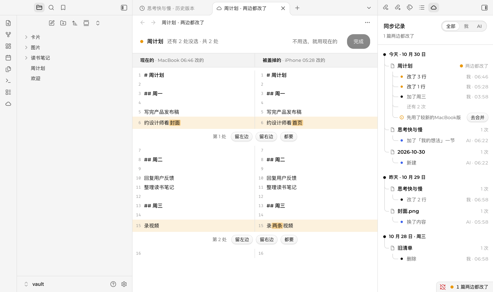
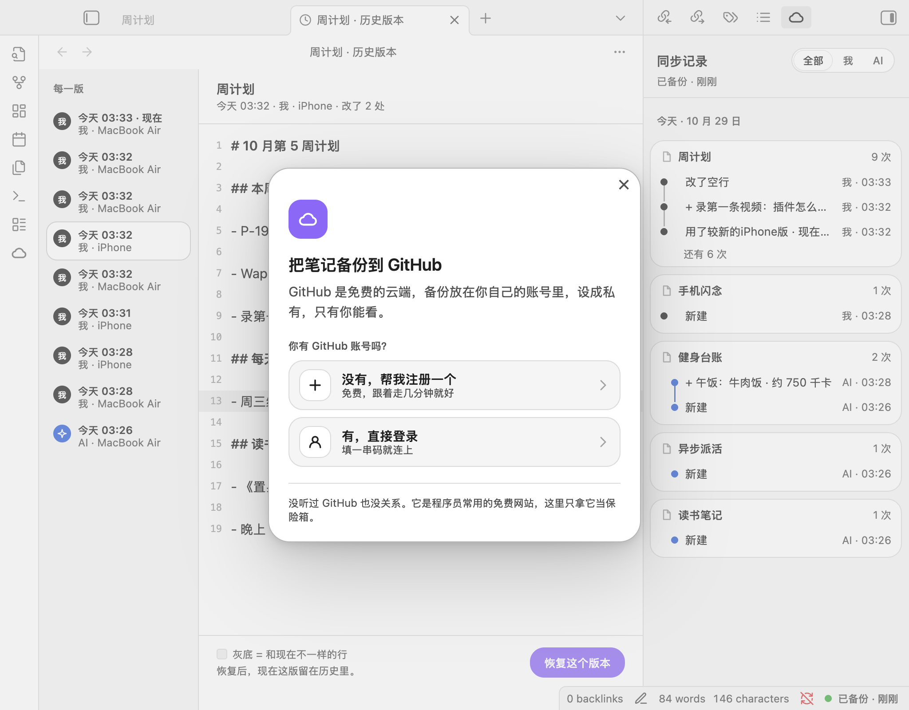
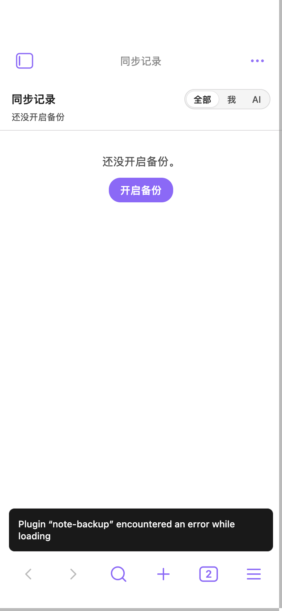
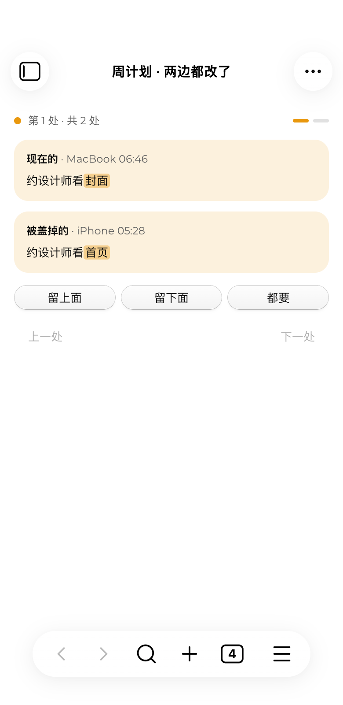

# 笔记备份 · Note Backup for Obsidian

只登录一次 GitHub，笔记自动备份、自动取回，电脑和手机保持一样。界面里没有一个 Git 术语。

*Back up your Obsidian vault to a private GitHub repo with one login. No Git knowledge needed; works on desktop and mobile.*



## 能做什么

- **只登录一次**：没有 GitHub 账号的，插件带着注册；有账号的，在 GitHub 填一串码就连上。插件自动在你账号下建一个私有仓库。
- **改完自动备份，自动取回**：改完 10 秒备份，每分钟看一眼别的设备有没有改。电脑和手机用同一套，不依赖本机 Git。
- **状态一眼看懂**：绿点 = 好了，闪 = 在跑，黄点 = 要你看一眼，空心 = 没网或暂停。大批备份可以暂停，下次从停下的地方接着传。
- **两边都改了**：不同段落自动合；同一段用修改时间较新的那份，被盖掉的那版留在历史里；之后在合并页一处一处选留哪边。
- **同步记录分清「我」和「AI」**：编辑器里打字改的算「我」，编辑器外(比如 AI 工具)改的算「AI」。每篇都能看历史版本、一键恢复、可撤销。
- **认出你原来的备份**：笔记库原来用 Obsidian Git 之类同步过的，接着用原来的仓库，不另建一份。

| 登录 | 同步记录 | 手机合并 |
|---|---|---|
|  |  |  |

## 安装

还没上架社区插件市场。两种装法：

1. **BRAT**：装 [BRAT](https://github.com/TfTHacker/obsidian42-brat)，添加 `kehaoran-ai/obsidian-note-backup`。
2. **手动**：从 [Releases](https://github.com/kehaoran-ai/obsidian-note-backup/releases) 下载 `main.js`、`manifest.json`、`styles.css`，放进笔记库的 `.obsidian/plugins/note-backup/`，在「第三方插件」里打开。

## 隐私与安全

- 登录用 GitHub 设备码：密码只在 GitHub 上输，插件拿不到。没有任何服务器，笔记直接在你的设备和你的 GitHub 之间传。
- 登录凭证存在 Obsidian 的系统密钥存储(旧版本存在本机存储)，不写进笔记库的任何文件。
- 备份仓库必须是私有的；遇到公开的同名仓库会拒绝连接。
- 按笔记库根目录的 `.gitignore` 跳过文件；`敏感信息/`、`sensitive/`、`secrets/`、`.env` 永远不上传。以点开头的文件夹(包括 `.obsidian`)不备份。
- 删除一律进回收站；超过 50MB 的文件跳过。
- AI 工具、命令行这些别的程序刚写的文件，备份不会拿旧版盖掉，也不会删掉；写回之前先读一次磁盘，对不上就留到下一轮再合。
- 权限说明：GitHub OAuth App 只能申请 `repo` 权限，它能读写你账号下的所有仓库，插件只用到备份那一个。

## 开发

```bash
npm install
npm run build      # 类型检查 + 打包出 main.js
npm test           # 单测
NB_TEST_TOKEN=$(gh auth token) NB_TEST_REPO=你的私有测试仓库 npm run test:github   # 真 GitHub 集成测试
```

代码结构见 [`src/CLAUDE.md`](src/CLAUDE.md)：`core` 是不依赖 Obsidian 和 GitHub 的同步引擎，可单测；`github` 是接口与登录；`obsidian` 是笔记库适配；`ui` 是界面。

## 许可

MIT
