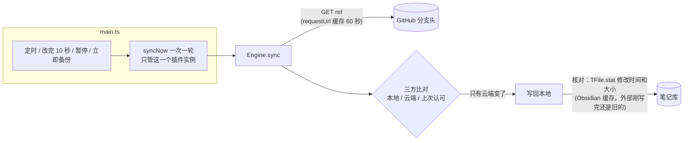
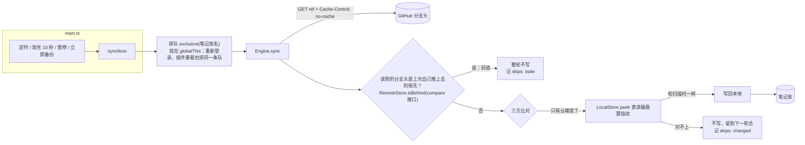

# 外部写入保护(0.1.1)

笔记库不只插件一个写入方：AI 工具、命令行、git 随时在写。0.1.0 在两种时机会把它们刚写的文件改回旧版或丢进回收站，0.1.1 补上三道闸。

## 改前

两个洞：

1. 刚推完紧跟的一轮，分支头读到的是缓存里推之前的值。拿旧云端一比，刚备份的篇像是「云端删了 / 云端改回去了」，写回就是删新文件、改回旧版；60 秒后缓存过期又取回来。
2. 写回前只看 Obsidian 缓存的修改时间和大小。外部进程刚写完、Obsidian 还没察觉时，核对放行，外部写的内容被盖掉。

## 改后

## 各管什么

- **Engine**(core/engine.ts)：同步引擎。新增的三道闸都在这里，不依赖 Obsidian 和 GitHub 的具体实现，单测能复现。
  - `exclusive`：按笔记库名排队，同一时间只跑一轮；出错照样抛给调用方，不堵后面的轮。
  - 旧分支头判断：只对见过的提交问一次 GitHub(没见过的是别的设备新推的，不用问)。
  - `skip`：两种跳过记进 `state.skips`，最多 100 条；真合不了的冲突照旧进 `state.clashes`(黄点)。
- **LocalStore.peek**(obsidian/vault-store.ts)：经 `vault.adapter` 直读磁盘，绕开 TFile.stat 缓存。
- **RemoteStore.isBehind**(github/remote.ts)：`compare/{读到的}...{上次推的}` 回 `ahead` 就是旧值。
- **GitHubRemote.head**：读分支头带 `Cache-Control: no-cache`，没变时 GitHub 回 304，不占限流。

复现与验证：`test/unit/race.test.ts` 8 题(旧代码 7 题挂，新代码全过)；`npm run test:github` 补「读到旧分支头不写」。
